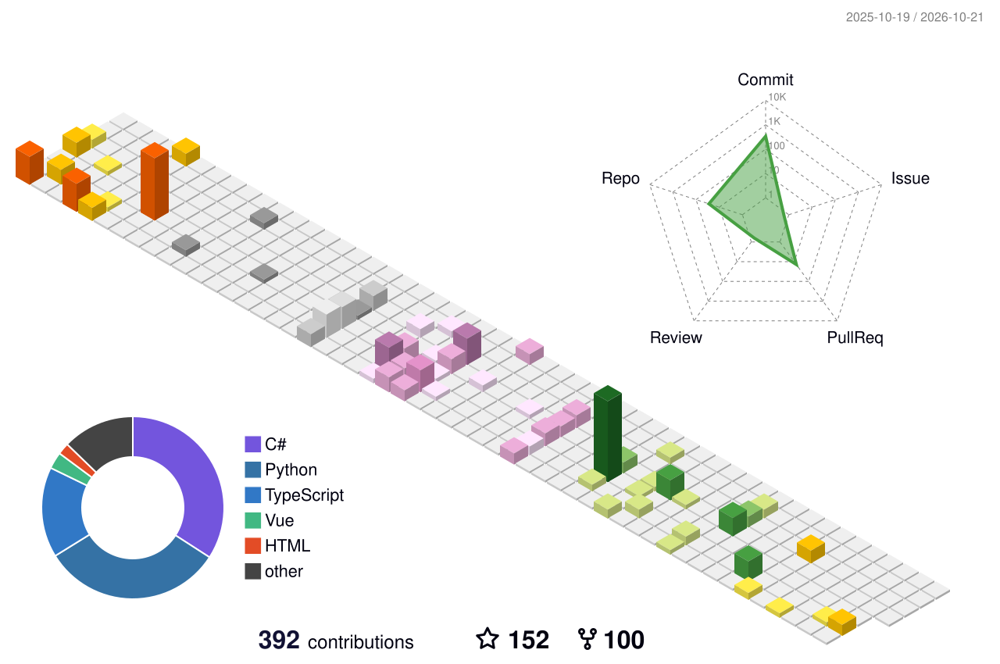



<a href="https://readme-typing-svg.herokuapp.com?font=Fira+Code&amp;size=22&amp;duration=3500&amp;pause=1200&amp;color=C34276&amp;center=true&amp;vCenter=true&amp;width=520&amp;height=60&amp;lines=%E2%9C%A8+%E6%9E%AB%E8%8E%B9%E3%81%AE%E5%B0%8F%E7%AA%9D+%7C+FengYing%27s+Home+%E2%9C%A8%3B%E6%84%BF%E4%BD%A0%E8%A2%AB%E4%B8%96%E7%95%8C%E6%B8%A9%E6%9F%94%E4%BB%A5%E5%BE%85+%E2%9C%BF%3BHappy+coding%2C+have+fun%21+%E2%9C%A8">
<picture>
  <source media="(prefers-color-scheme: dark)" srcset="https://readme-typing-svg.herokuapp.com?font=Fira+Code&amp;size=22&amp;duration=3500&amp;pause=1200&amp;color=FFB6C1&amp;center=true&amp;vCenter=true&amp;width=520&amp;height=60&amp;lines=%E2%9C%A8+%E6%9E%AB%E8%8E%B9%E3%81%AE%E5%B0%8F%E7%AA%9D+%7C+FengYing%27s+Home+%E2%9C%A8%3B%E6%84%BF%E4%BD%A0%E8%A2%AB%E4%B8%96%E7%95%8C%E6%B8%A9%E6%9F%94%E4%BB%A5%E5%BE%85+%E2%9C%BF%3BHappy+coding%2C+have+fun%21+%E2%9C%A8" />
  
</picture>
</a>

## 💻 技术栈 | Tech Stack

<a href="https://skillicons.dev/icons?i=cs%2Cpython%2Chtml%2Ccss%2Cjs%2Cunity%2Cdotnet%2Cts&amp;theme=light">
<picture>
  <source media="(prefers-color-scheme: dark)" srcset="https://skillicons.dev/icons?i=cs%2Cpython%2Chtml%2Ccss%2Cjs%2Cunity%2Cdotnet%2Cts&amp;theme=dark" />
  
</picture>
</a>

## 📊 GitHub 统计 | GitHub Stats

<a href="https://github-readme-stats-one-bice.vercel.app/api?username=FengYing1314&amp;show_icons=true&amp;theme=default&amp;hide_border=true&amp;title_color=C34276&amp;icon_color=C34276&amp;text_color=434D56&amp;bg_color=FFF7FB">
<picture>
  <source media="(prefers-color-scheme: dark)" srcset="https://github-readme-stats-one-bice.vercel.app/api?username=FengYing1314&amp;show_icons=true&amp;theme=dark&amp;hide_border=true&amp;title_color=F3A6C8&amp;icon_color=F3A6C8&amp;text_color=C9D1D9&amp;bg_color=0D1117" />
  
</picture>
</a>
<a href="https://github-readme-stats-one-bice.vercel.app/api/top-langs/?username=FengYing1314&amp;layout=compact&amp;theme=default&amp;hide_border=true&amp;title_color=C34276&amp;text_color=434D56&amp;bg_color=FFF7FB&amp;icon_color=C34276">
<picture>
  <source media="(prefers-color-scheme: dark)" srcset="https://github-readme-stats-one-bice.vercel.app/api/top-langs/?username=FengYing1314&amp;layout=compact&amp;theme=dark&amp;hide_border=true&amp;title_color=F3A6C8&amp;text_color=C9D1D9&amp;bg_color=0D1117&amp;icon_color=F3A6C8" />
  
</picture>
</a>

<a href="https://github-readme-streak-stats.herokuapp.com/?user=FengYing1314&amp;theme=default&amp;hide_border=true&amp;ring=C34276&amp;fire=C34276&amp;currStreakLabel=C34276&amp;background=FFF7FB">
<picture>
  <source media="(prefers-color-scheme: dark)" srcset="https://github-readme-streak-stats.herokuapp.com/?user=FengYing1314&amp;theme=dark&amp;hide_border=true&amp;ring=F3A6C8&amp;fire=F3A6C8&amp;currStreakLabel=F3A6C8&amp;background=0D1117" />
  
</picture>
</a>

<picture>
  <source media="(prefers-color-scheme: dark)" srcset="https://raw.githubusercontent.com/FengYing1314/FengYing1314/output/github-contribution-grid-snake-dark.svg" />
  
</picture>

  

<a href="https://fabianocouto-activity-graph.vercel.app/graph/?username=FengYing1314&amp;theme=minimal&amp;bg_color=FFF7FB&amp;color=434D56&amp;line=C34276&amp;point=C34276&amp;hide_border=true">
<picture>
  <source media="(prefers-color-scheme: dark)" srcset="https://fabianocouto-activity-graph.vercel.app/graph/?username=FengYing1314&amp;theme=minimal&amp;bg_color=0D1117&amp;color=C9D1D9&amp;line=F3A6C8&amp;point=F3A6C8&amp;hide_border=true" />
  
</picture>
</a>

  

<a href="./profile-3d-contrib/profile-season-animate.svg">
<picture>
  <source media="(prefers-color-scheme: dark)" srcset="./profile-3d-contrib/profile-night-view.svg" />
  
</picture>
</a>

## 📬 联系方式 | Contact

<strong>🌟 一起在代码的世界里创造小小奇迹！🌟</strong> 

轻轻记录来过这个世界的足迹～

